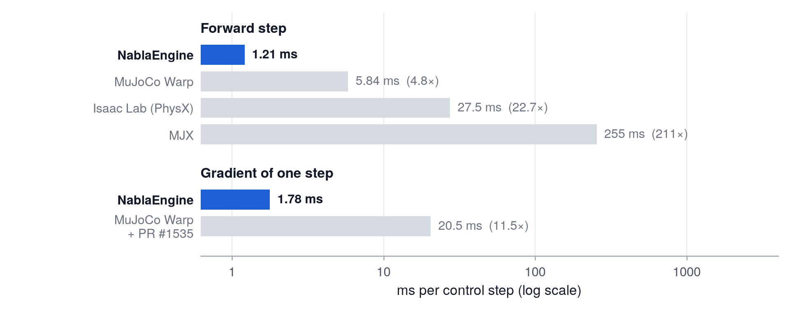

# NablaEngine

**Fast, exact simulation gradients for the Unitree G1.**

*Pronounced "Nabla Engine".*

<p align="center"></p>

<sub>Time per 20 ms control step for 4096 Unitree G1 worlds on one NVIDIA RTX PRO 6000: the forward step, and one
step with its gradient from the input state. MuJoCo Warp and MJX simulate the same model (medians over 3 processes,
`docs/results/paper_rtx6000/paper_bench.md`); Isaac Lab runs its own G1 asset with its task defaults (median over
rounds, `docs/results/physx_rtx6000/physx_bench_results.md`).</sub>

NablaEngine is a differentiable GPU physics engine for the Unitree G1 humanoid. It simulates thousands of worlds per
call with MuJoCo's physics and returns analytic gradients of every step with respect to the state and the actions,
for first-order policy learning, trajectory optimization and system identification. It plugs into JAX
(`jax.jit`, `jax.grad`, `lax.scan`) and PyTorch (`torch.autograd`, CUDA graphs, `torch.compile`) as a differentiable
function, with bitwise the same results in both.

- **Fast.** One control step of 4096 worlds in 1.21 ms, its gradient in 1.78 ms, and the full 71x99 Jacobian of the
  step in 9.7 µs per world (RTX PRO 6000).
- **Exact.** Against float64 MuJoCo on 16,384 held-out states: forward median relative error 8.5e-7, gradient median
  relative errors 3.6e-5 / 1.0e-5 / 1.9e-6 (qpos / qvel / ctrl) against float64 finite differences
  (`docs/results/paper_accuracy_heldout_v100.md`).
- **Deterministic.** Outputs and gradients are bitwise identical from run to run.

**Used by.** [∇Mimic (NablaMimic)](https://github.com/OamIcs/NablaMimic), whole-body motion tracking learned with
the engine's simulation gradients.

**Paper.** [∇Mimic: Ultra-Efficient Humanoid Control with Differentiable Simulation](https://sailab.ai/nablamimic/assets/nablamimic.pdf) ([project page](https://sailab.ai/nablamimic/))

## Scope

NablaEngine is specialized for the Unitree G1 (the mjlab model), the first robot it supports: contacts between
spheres, capsules and the floor, joint limits, PD position actuators, MuJoCo's Newton solver and implicitfast
integration, in float32. Other models are rejected with an error that names the unsupported features.

Requirements: Linux x86_64, an NVIDIA GPU of compute capability 7.0 or newer (tested: V100, RTX 3090, H100, RTX PRO
6000), Python 3.12, and a CUDA 12.x toolkit (nvcc) for the one-time build of the CUDA library (about 15 s, cached).

## Installation

```bash
git clone https://github.com/OamIcs/NablaEngine.git NablaEngine && cd NablaEngine
scripts/setup_env.sh               # a Python 3.12 environment in .dk_env/ with the tested versions
source .dk_env/activate.sh
scripts/verify.sh --quick          # checks the installation in a few minutes
```

For PyTorch, add it to that environment and build the engine's library once (`docs/api_torch.md`):

```bash
pip install torch                  # a CUDA 12 build; on a V100 the cu126 wheels
python -m nablaengine.torch_ffi build
```

Options, a PyTorch-only environment, a manual installation and use outside the checkout: `docs/install.md`.

## Quick start

JAX:

```python
import jax
import jax.numpy as jnp

from nablaengine import fixtures, jax_ffi

jax_ffi.init()                         # builds the CUDA library on first use, then loads it from the cache
z = fixtures.load_corpus("mf_s0")      # 4096 states of the G1
B = 256
qpos, qvel, warm, ctrl, friction, com = (jnp.asarray(z[k][:B]) for k in
                                         ("qpos", "qvel", "qacc_warmstart", "ctrl", "friction", "com"))

qpos1, qvel1, warm1 = jax_ffi.step(qpos, qvel, warm, ctrl, friction, com)  # one control step: 4 substeps of 5 ms


def loss(ctrl):
    q, v, _ = jax_ffi.step(qpos, qvel, warm, ctrl, friction, com)
    return jnp.sum(v ** 2)


g = jax.jit(jax.grad(loss))(ctrl)      # through the analytic adjoint
```

PyTorch (no JAX needed):

```python
import torch

from nablaengine import fixtures, torch_ffi

torch_ffi.init()                       # loads the library built by `python -m nablaengine.torch_ffi build`
z = fixtures.load_corpus("mf_s0")
qpos, qvel, warm, ctrl, friction, com = (torch.from_numpy(z[k][:256]).cuda() for k in
                                         ("qpos", "qvel", "qacc_warmstart", "ctrl", "friction", "com"))
ctrl.requires_grad_()
qpos1, qvel1, warm1 = torch_ffi.step(qpos, qvel, warm, ctrl, friction, com)
(qvel1 ** 2).sum().backward()          # ctrl.grad through the analytic adjoint
```

Inputs are float32 arrays with the worlds as the leading dimension: `qpos (B, 36)`, `qvel (B, 35)`, the solver's warm
start `warm (B, 35)`, the position targets `ctrl (B, 29)`, and per-world foot `friction (B,)` and torso
centre-of-mass offset `com (B, 3)` for domain randomization. Each world holds up to 64 contacts and 192 constraint
rows; a world beyond them (e.g. deep interpenetration after a fall) drops the extra ones and is flagged and counted
(`docs/api.md`, Diagnostics).

## Documentation

- `docs/api.md`: the JAX interface: options, gradient modes, kinematics outputs, rollouts with `lax.scan` and
  `jax.checkpoint`, diagnostics.
- `docs/api_torch.md`: the PyTorch interface: the build artifact, CUDA graphs, `torch.compile`, several GPUs.
- `docs/verification.md`: what `scripts/verify.sh` checks, against which references.
- `docs/configuration.md`: environment variables and build switches.
- `benchmarks/README.md`, `scripts/paper_bench/README.md`: reproduce the accuracy tables and the timings.

## Licence

Apache License 2.0 (`LICENSE`), Copyright 2026 The NablaEngine Authors. `NOTICE` and `THIRD_PARTY_NOTICES.md` list the
code derived from MuJoCo Warp and MuJoCo (Apache-2.0) and the model, which is derived from MuJoCo Menagerie's Unitree
G1 (BSD-3-Clause, `fixtures/mjlab/LICENSE`) with mjlab's configuration (Apache-2.0).

## Citation

A paper reference will be added here. Until then, please cite the software (`CITATION.cff`):

```bibtex
@software{nablaengine,
  title  = {NablaEngine: fused CUDA physics with an analytic adjoint for the Unitree G1},
  author = {{The NablaEngine Authors}},
  year   = {2026},
  url    = {https://github.com/OamIcs/NablaEngine}
}
```
